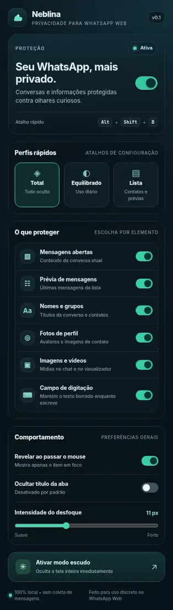

# Neblina — Privacidade no WhatsApp Web

Extensão **independente e gratuita** para Google Chrome (Manifest V3) que desfoca partes sensíveis do WhatsApp Web. Feita com JavaScript e CSS puros, sem dependências, sem analytics, sem acesso a outros sites.



## Funcionalidades

- **Proteção por categoria:** mensagens, últimas mensagens, nomes/grupos, fotos de perfil, mídias e campo de digitação.
- **Três perfis:** Total, Equilibrado e Lista. É possível personalizar qualquer configuração.
- **Controle de intensidade:** desfoque de 4 até 24 pixels.
- **Revelação ao passar o mouse:** opcional para mensagens, nomes, prévias e mídias; o campo de digitação permanece oculto quando está em foco e pode ser revelado ao passar o mouse, quando a opção de revelação está ativada.
- **Modo escudo:** overlay na página para ocultar tudo com um clique.
- **Título neutro da aba:** funcionalidade opcional, desativada por padrão, para ocultar o nome no navegador.
- **Atalho de teclado:** `Alt + Shift + B` ativa/desativa a proteção.
- **Configurações locais:** somente `chrome.storage.local`; mensagens não são armazenadas ou transmitidas pela extensão.

## Instalação (sem publicar na Web Store)

1. Baixe e extraia o arquivo `privacidade-whatsapp.zip`.
2. Abra `chrome://extensions` no Chrome.
3. Ative **Modo do desenvolvedor**.
4. Clique em **Carregar sem compactação** e selecione a pasta extraída, a que contém `manifest.json`.
5. Abra ou atualize `https://web.whatsapp.com/`.
6. Clique no ícone **Neblina** ao lado da barra de endereços.

> Desative a extensão de privacidade anterior para evitar regras CSS conflitantes. Ao desenvolver, alterações nos arquivos exigem clicar no botão de recarregar a extensão e atualizar a guia do WhatsApp.

## Desenvolvimento

Nenhum `npm install` é necessário. O Chrome executa os arquivos diretamente. Estrutura:

```
manifest.json           # Manifest V3 / acesso restrito ao WhatsApp Web
background.js           # Atalho e estado do ícone
shared/config.js        # Configuração, defaults e validação
src/content.js          # Aplica opções, título da aba, modo escudo
src/blur.css            # Desfoque por categoria
popup/index.html        # Interface
popup/style.css         # Design
popup/popup.js          # Controles
icons/                  # Ícones originais
```

Teste rápido: `python -m pytest tests/` (requer `pytest` e `playwright`); navegador Chromium em execução de testes.

## Repositório e versionamento

Código-fonte: **https://github.com/bielcerroni/privacidade-whatsapp**.

A branch principal é `main`. Alterações podem ser revisadas por pull request antes de serem incorporadas.

Para clonar e contribuir:

```powershell
git clone https://github.com/bielcerroni/privacidade-whatsapp.git
cd privacidade-whatsapp
```

## Compatibilidade e limitações

O WhatsApp Web altera seu HTML frequentemente. Os estilos usam seletores semânticos e fallbacks; novas versões podem exigir ajustes. A proteção **oculta visualmente** informações na tela e não substitui o bloqueio de sessão, criptografia ou cuidados com o dispositivo. O modo escudo reduz a chance de exposição por omissões de seletores.

## Privacidade e permissões

- `storage`: guarda preferências **locais** da extensão.
- `https://web.whatsapp.com/*`: injeta estilos e controles **somente** nesse endereço.
- Sem requisições a serviços próprios, sem coleta de texto/mensagens, sem scripts remotos.

Consulte [PRIVACY.md](PRIVACY.md).

## Origem da ideia

Projeto independente inspirado funcionalmente na [Extensão de Privacidade para o WhatsApp Web](https://chromewebstore.google.com/detail/jbojhlhhggfmmkpefknmbdhlaghehini), disponibilizada sob licença MIT. O código, o visual e os ícones deste repositório foram escritos especificamente para o Neblina, sem copiar os arquivos da extensão fornecida.

**Aviso:** WhatsApp é uma marca de seus respectivos titulares. Neblina é um projeto independente e não tem vínculo com WhatsApp ou Meta.

## Licença

MIT — veja [LICENSE](LICENSE).


## Versão de desenvolvimento 0.1.0

- `Ocultar título da aba` agora vem **desativado por padrão**.
- O seletor de **nomes e grupos** foi reforçado para o cabeçalho atual do WhatsApp Web.
- O **campo de digitação** permanece borrado mesmo durante a digitação.
- O **popup** recebeu revisão visual com layout mais limpo e profissional.

## Correções da versão 0.1.2

- O nome do contato/grupo no cabeçalho é mascarado somente no texto, não no botão inteiro, eliminando o quadradinho.
- Nomes e campo de digitação são revelados ao passar o mouse; somente o foco de teclado não revela o rascunho.
- Avatares de contatos, grupos e participantes são protegidos por uma máscara circular interna, sem halo fora da foto.
- Grupos cujos avatares chegam dinamicamente também são detectados; imagens pequenas arredondadas e avatares com background-image são abrangidos.
- O desfoque de mídias respeita o recorte da imagem; texto de mensagens e mídia não acumulam dois filtros.
- Continua na linha de desenvolvimento **0.1.x**, sem lançamento 1.0.


## Ajustes da v0.1.2

- blur do nome com máscara mais difusa para esconder melhor o comprimento do contato;
- foto de perfil dentro da conversa continua visível, porém borrada, e revela no hover;
- blur das mensagens agora cobre a bolha inteira, incluindo horário e checks.


### Ajuste visual da v0.1.2
- Máscaras de nomes usam a cor de fundo do item e largura consistente, sem barras cinzas.
- Fotos reais de perfil ficam sempre presentes com desfoque sutil de 5px; hover revela sem bloqueios.
- A bolha da mensagem é desfocada como um todo, incluindo informações de horário e leitura.
